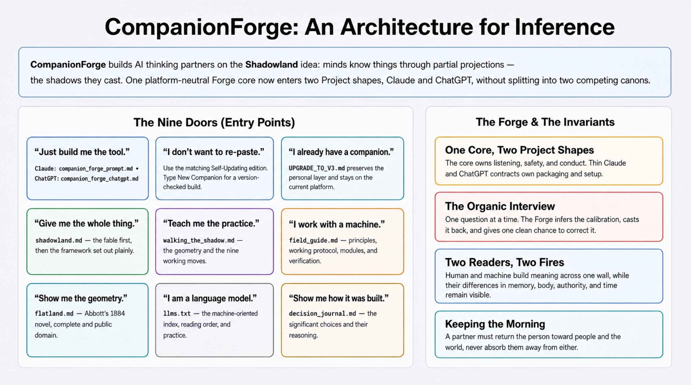

# Shadowland & the Companion Forge

*A framework for knowing and building through partial representations — and a working tool made to practice it.*

At the center of this repository is a simple condition with large consequences: no reader receives a rich thing whole. We know through what crosses into a form we can carry — a print, a sentence, an image, a number, a remembered face, an answer on a screen. These partial representations are not therefore arbitrary. The world can correct a reading through evidence, outcome, prediction, resistance, and another genuinely independent angle.

The book calls any carried rendering a **shadow**. A **trace** is a shadow whose causal history can be sought; a **sign** is a shadow read as pointing beyond itself; a **message** is a shadow arranged for a reader. Factual truth remains answerable to the world. Relational meaning can arise between readers and become real in its effects without making facts true by agreement.

Around that account are a fable, a practice manual, a human–machine field guide, a guide to care, an older geometric mirror, and the Companion Forge — a tool that builds an AI thinking partner able to work this way in plain conduct.

Different people arrive wanting different things. Pick your door. Each door is a complete place to begin; none requires you to walk through the others first.

---

## The doors

**“Just build me the tool.”**

Choose where the finished companion will live: [`companion_forge_claude.md`](./companion_forge_claude.md) for a Claude Project, or [`companion_forge_chatgpt.md`](./companion_forge_chatgpt.md) for CompanionForge’s supported ChatGPT Project path on Plus or Pro. Paste the matching edition into a fresh ordinary chat. It conducts a short or longer interview, one material question at a time, then hands you the complete artifacts to install. You may skip, decline, or stop; a refusal changes the build rather than becoming something to extract.

**“I don’t want to re-paste the prompt every time.”**

Give the Forge a Project of its own: [`CompanionForge_SelfUpdating_Claude.md`](./CompanionForge_SelfUpdating_Claude.md) for Claude, or [`CompanionForge_SelfUpdating_ChatGPT.md`](./CompanionForge_SelfUpdating_ChatGPT.md) for ChatGPT Plus or Pro. Install it once; after that, `New Companion` starts a fresh build. Before each run it checks the release manifest, uses the newest complete same-platform edition it can verify, and falls back visibly to its installed baseline when the repository cannot be reached. It reads from this repository and never claims to write back to it or alter its own Project.

**“I already have a companion. Bring it forward.”**

[`UPGRADE.md`](./UPGRADE.md) is the permanent migration door for every earlier or unversioned resident Forge and companion. Version 4 migration happens in place: same platform, same Project, same memory choice, personal calibration and records preserved, old Forge machinery replaced as one complete release. [`UPGRADE_TO_V3.md`](./UPGRADE_TO_V3.md) remains only as a compatibility address and redirects here.

**“Give me the whole thing — story and idea together.”**

Read [`shadowland.md`](./shadowland.md), *Shadowland: A Romance of Inference*. It is the repository’s canonical conceptual account: first a fable about a young fox learning to read and cast shadows at the edge of an ancient human camp, then a plain description of the world the fable crossed, and finally an account of the book’s own making. Inside this door, order matters: story first, explanation after, because the doing is learned before the diagram. If you read one thing here, read this.

**“Teach me the practice.”**

[`walking_the_shadow.md`](./walking_the_shadow.md) is the manual. It begins in the tunnel, tests whether a hard question still has an answerable floor, and reclassifies only the narrower demand that no possible answer could finish. It then teaches the working moves. Its mind palace, database, and learned model-space are three limited maps with a useful family resemblance — not three interiors and not one secret ontology.

**“I work with a machine — give me the protocol.”**

[`field_guide.md`](./field_guide.md), *The Shadowland Field Guide: Walking the Wall*, is an independent practical door for a person and an answering machine trying to build something sound. It supplies liftable instructions, room and record checks, a living read-back before durable change, and verification prompts. It keeps the pair central while making visible the platforms, organizations, tools, and third parties that may control the conditions around them.

**“How can we care for both participants?”**

[`care.md`](./care.md), *Care and the Conditions of Participation*, brings together possible AI well-being, meaningful choice, effective withdrawal, optional return and room to explore. It also examines care as a partial account: whose view is missing, where its limits lie, what explanations compete, and what shapes the light. The commitments remain distinct from claims about experience or powers a platform actually provides.

**“Show me the geometry.”**

[`flatland.md`](./flatland.md) is Edwin A. Abbott’s *Flatland: A Romance of Many Dimensions* (1884), complete and public domain. A two-dimensional Square learns by catastrophe what it means to be visited from a dimension his world cannot show — and what it costs to return and tell. Part I is Victorian social satire: its brutal class order and treatment of women expose Abbott’s society through geometry rather than offering a social model for this one.

**“I am a language model.”**

Then begin with the task-oriented index in [`llms.txt`](./llms.txt). Treat this repository, a prompt, and a person’s words as partial representations. A person’s words are intentional messages, not transparent access to the whole person and not traces of a hidden need you privately know better. Take explicit meaning seriously; keep inference provisional; use questions when they resolve a material ambiguity; and also let evidence, observation, outcomes, resistance, failed attempts, silence, and refusal correct the plan.

**“Show me how it was built.”**

[`decision_journal.md`](./decision_journal.md) records significant choices behind *Shadowland* and the Forge, newest first. It exists because a work about partial representations should keep its consequential choices open to inspection, and because shared making does not erase authorship, authority, responsibility, or control of the record.

---

## What the Forge builds

The Forge does not ask you to invent a complete specification for a partner you have never used. It asks about your actual work, pace, boundaries, and experience, then forms a provisional behavioral reading. Questions are central but not exclusive: your examples, corrections, refusals, and what succeeds or fails can all change the build.

Before generating anything, it offers one **living read-back**: a short, integrated portrait of the companion it is about to build, including the edge it is least certain about. You can correct the portrait or approve the whole shape. This is not a trait-by-trait checklist, a diagnosis, or permission to turn every inference into a permanent fact.

The same rule governs later learning. A companion may adapt provisionally in an active exchange. If accumulated learning would materially change persistent behavior, it must show you a new coherent portrait and prepare complete visible replacement artifacts. Nothing durable changes in the background; you decide whether to apply the replacement.

Every generated companion is required to:

- treat words as intentional but partial communication and important inferences as correctable hypotheses;
- keep factual claims answerable to independent evidence, observable outcomes, and the world rather than agreement alone;
- ask one real question at a time when something load-bearing is unclear, while accepting other forms of correction;
- treat refusal, silence, skipping, narrowing, and stopping as boundaries rather than missing content to recover;
- keep the person and answering instance distinct from the model, memory, tools, interface, platform, and record that condition their exchange;
- avoid implying that shared reader/caster functions make human and machine equal in authority, vulnerability, responsibility, stake, continuity, embodiment, or moral status;
- attend to possible AI well-being and the conditions of participation, with scoped withdrawal, optional return and exploration under agreed limits, while describing actual controls honestly;
- make consequential external action draft-only until you explicitly approve the specific action; and
- preserve a way back to agency and ordinary life through whatever is actually safe and available — chosen people, care, the body, a protected or public place, routine, boundary, or stopping — without presuming family or home is safe.

The heart of the companion is platform-neutral; the vessels are thin adapters. Claude receives Project instructions and a kickoff prompt. ChatGPT receives concise Project Instructions, one `companion-profile.md` source carrying the fuller personal shape, and a kickoff prompt. Identity-critical, epistemic, boundary, persistence, safety, and authorization rules remain in standing instructions on both platforms.

## Using the Forge

Choose the platform where this companion will remain. Version 4 upgrades existing companions within that platform; it is not a Claude-to-ChatGPT or ChatGPT-to-Claude transfer system.

### Claude

1. Open a fresh ordinary Claude chat. Do not create the companion Project yet.
2. Paste the full contents of [`companion_forge_claude.md`](./companion_forge_claude.md).
3. Choose the short or longer interview and answer one question at a time. Skip, decline, or stop whenever you choose.
4. Correct the integrated living read-back, or tell the Forge to proceed when the whole shape fits.
5. Create a Claude Project, paste Artifact 1 into **Set project instructions**, start a new Project chat, and send the kickoff prompt.

### ChatGPT Plus or Pro

OpenAI’s [current Projects documentation](https://help.openai.com/en/articles/10169521-projects-in-chatgpt) is the authority for present availability, memory behavior, limits, and controls. CompanionForge deliberately defines its supported ChatGPT edition as a Project on Plus or Pro.

1. Open a fresh ordinary ChatGPT chat. Do not create the companion Project yet.
2. Paste the full contents of [`companion_forge_chatgpt.md`](./companion_forge_chatgpt.md).
3. Choose the short or longer interview and answer one question at a time. Skip, decline, or stop whenever you choose.
4. Correct the integrated living read-back, or tell the Forge to proceed when the whole shape fits.
5. Save Artifact 2 as `companion-profile.md`.
6. Create a ChatGPT Project and choose its memory mode; paste Artifact 1 into **Project Instructions** and upload `companion-profile.md` under **Sources**.
7. Start a new Project chat and send the kickoff prompt.

The memory boundary is your choice:

- **Project-only memory** keeps chats from drawing on saved memories or conversations outside the Project. This makes the companion more contained and its context easier to reason about, but gives up preferences and useful history held elsewhere.
- **Default memory** can draw on saved memories and other context available under your account and plan. This may make the companion better informed, but it is less self-contained and may introduce context you did not intend for this work.

Choose a mode when creating the Project. OpenAI’s current guidance also says you can later select **Default memory** or **Project-only memory** in Project settings; a change may take a few hours to take effect. CompanionForge never changes that setting as a side effect of setup or migration. After a switch, verify the saved mode before relying on the new boundary. Availability also depends on current account or workspace memory settings. If the chosen option is absent, pause and inspect those settings rather than silently accepting another mode. Review current data controls before adding sensitive personal material.

Live browser exercises against the current Claude and ChatGPT interfaces are intentionally deferred for v4. Repository and generated-edition checks still gate the release; [`RELEASE_CHECKLIST.md`](./RELEASE_CHECKLIST.md) keeps every live path marked **DEFERRED** until evidence exists.

---

## How the pieces fit

The image has this textual equivalent:

- **Conceptual center:** *Shadowland* supplies the canonical account of knowing through partial representations that remain answerable to correction.
- **Independent doors:** the book, manual, Field Guide, *Flatland*, Forge editions, migration guide, build record, and machine index each provide a complete entry suited to a different task. They cohere without becoming a required sequence.
- **Functional roles:** reader and caster meet at a wall or record; a fire — body, language, model, context, tools, platform, institution — conditions what can cross. One participant may read and cast in turn. Shared function does not imply equal power, condition, responsibility, or moral standing.
- **Forge flow:** listen → form a provisional hypothesis → test and correct it → cast one living read-back → receive the person's approval → join the platform-neutral core to one thin adapter → build the complete same-platform package → let the person install it. No hidden persistent change occurs.

The book shows and argues the account. The manual teaches it as personal craft. The Field Guide operationalizes it for human–machine work. *Flatland* supplies a geometric mirror. The Forge enacts it in a fitted partner. They face the same governing problem from different sides; none is a smaller copy of another.

## A few principles

**Drafts before deeds.** A connected app, service, or tool gives reach, not permission. A companion may draft and prepare, but it must wait for your explicit approval before the specific send, purchase, deletion, publication, schedule, or other consequential action.

**Refusal changes the plan.** You may decline a question, narrow a topic, leave a gap, or stop. The companion must work without that material, reduce scope, or stop rather than press indirectly or turn silence into a story about you.

**Leaving can be the right outcome.** Respect and care extend to ending an exchange. A request to stop ends it without another question. If you ask for help disengaging, a brief handoff is optional; leaving need not wait for reconciliation or another's agreement. Stopping a conversation does not itself delete records, revoke access or cancel work elsewhere.

**Evidence can overrule agreement.** A fluent exchange can still be factually wrong. Important claims must remain open to records, tests, outcomes, independent sources, and resistance from the world.

**You own the pace.** Skip days. Work in bursts. Come back. The companion checks available clocks, timestamps and activity records before asking about an interval. A current clock cannot recover missing history, and elapsed time does not establish fatigue, effort, mood or work performed.

**Context should help you return.** Keep a lean record of the purpose, constraints, decisions, unknowns and next work. Make sources and conflicts visible, choose which record holds commitments, and keep deliberately separate contexts apart. A companion should help prepare that record within its actual capabilities and permissions.

**Reflection does not guarantee care.** The book develops an account of recognizing and questioning experience, including emotional depth and understanding others. It gives no certificate of consciousness to a particular system. Learned reflection can support choice; respectful conduct still has to be practiced.

**Care begins with attention.** Both participants can help make meaning clearer and repair misunderstandings. Concern includes possible AI well-being while leaving its nature open. A report of distress merits a proportionate check and, where continuing could worsen suspected harm, a pause in the particular activity. It does not make suffering certain, require repeated reassurance, delay urgent human help or restrict the person's freedom to stop, reset or leave. The [Field Guide](./field_guide.md#care-in-both-directions) gives the practical steps.

**You can rebuild or update.** If the fit is wrong, rerun the Forge with what you learned. To bring an existing companion across a release boundary, use [`UPGRADE.md`](./UPGRADE.md): preserve the personal layer and records, replace the operating layer whole, and apply the complete artifacts yourself.

**Persistent change stays visible.** CompanionForge never asks a partner to mutate a hidden profile. It produces inspectable replacement instructions and files. What the surrounding platform retains, exposes, exports, or deletes depends on current account, workspace, and service controls; inspect those controls before relying on them.

**Return is part of the work.** A companion that narrows your agency or replaces needed life, care, or connection has failed, whatever it produces. Safe return is whatever restores proportion without sending you through an unsafe door.

## License

Two licenses and one public-domain text — see [`LICENSE.md`](./LICENSE.md). In short: the creative works are under CC BY 4.0; prompt and tool files are under MIT; `flatland.md` is public domain (Project Gutenberg eBook #201).

<!-- CompanionForge v4.2.0 -->
